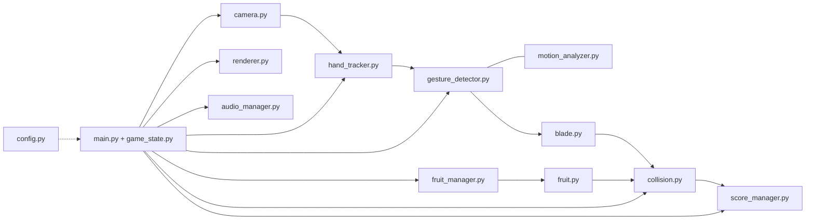
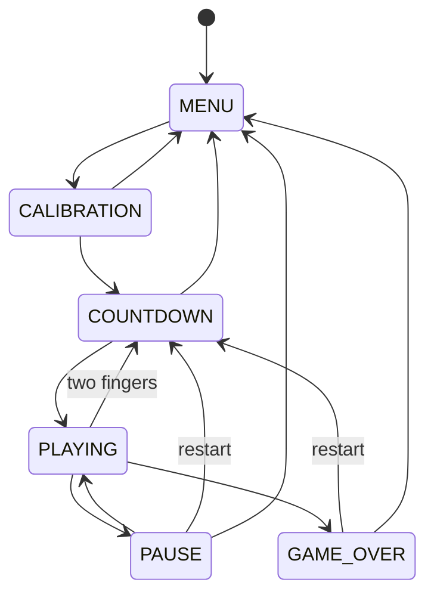

# Fruit Cutting Gesture Game

A single-player, locally run game: slice flying fruit by swiping your **index finger** in front of a webcam. Avoid the bombs.

## 1. Features
- Hand tracking with MediaPipe (index fingertip), smoothing and hand-loss recovery
- Gesture detector using a recent-history window with **distance + speed** thresholds; one swipe = one cut
- Fading blade trail; segment-vs-circle collision so fast swipes never "skip" a fruit
- Apple (+10), Watermelon (+20), Orange (+15), Banana (+15), Strawberry (+12), Bomb (-1 life) - all in `src/config.py`
- Combos (x2/x3/x4), critical-cut bonus, levels, timer, lives, persistent high score
- States: MENU, CALIBRATION, COUNTDOWN, PLAYING, PAUSE, GAME_OVER
- English and Khmer UI labels (`TRANSLATIONS` in `config.py`)
- Works without any asset files: fruits are drawn procedurally and sounds are synthesised

## 2. Technology
Python 3.11/3.12 - OpenCV (capture) - MediaPipe (hand landmarks) - Pygame (rendering/audio/input) - NumPy.

## 3. Folder structure
```
fruit-cutting-game/
├── main.py
├── requirements.txt
├── README.md
├── src/
│   ├── __init__.py          (extra file: makes `src` a regular package)
│   ├── camera.py            webcam open/read/mirror/release
│   ├── hand_tracker.py      MediaPipe (two back-ends), fingertip -> screen coords
│   ├── motion_analyzer.py   history, smoothing, distance/speed/direction
│   ├── gesture_detector.py  cut recognition, one-cut-per-swipe logic
│   ├── blade.py             trail points, fading, strokes
│   ├── fruit.py             fruit/bomb physics, hitbox, slice pieces
│   ├── fruit_manager.py     spawning, difficulty, removal
│   ├── collision.py         segment/circle geometry, duplicate-hit prevention
│   ├── game_state.py        state machine + countdown
│   ├── score_manager.py     score, combo, lives, timer, level, high score
│   ├── renderer.py          all pygame drawing
│   ├── audio_manager.py     sounds/music with fallbacks
│   └── config.py            every tunable value
├── assets/{fruits,effects,sounds,fonts,ui}/
├── tests/{test_motion,test_gesture,test_collision,test_score}.py
└── docs/project-requirements.docx   <- copy your requirements document here
```
`highscore.json` is created at runtime next to `main.py`.

## 4. Setup (Windows)
```bat
cd fruit-cutting-game
py -3.12 -m venv .venv
.venv\Scripts\activate
python -m pip install --upgrade pip
pip install -r requirements.txt
python main.py
```
Use Python 3.11 or 3.12. MediaPipe versions in `requirements.txt` do not support Python 3.13+.

The Windows steps above already work. Leave them as they are on a Windows PC.

## 5. Setup (Linux)
```bash
cd fruit-cutting-game
python3 -m venv .venv
source .venv/bin/activate
python -m pip install --upgrade pip
pip install -r requirements.txt
python main.py
```
Use the same Python 3.11 or 3.12 requirement. If `python3 -m venv` says `ensurepip` is missing, install the distro package `python3.12-venv` (the package name matches your Python version), delete `.venv`, and run the commands again. Do not reuse a `venv` or `venv311` folder copied from Windows.

## 6. Webcam permissions & troubleshooting
- Windows: Settings > Privacy & security > Camera > allow desktop apps.
- Linux: the game opens `/dev/video0`. Another app may already be using it.
- Close Zoom/Teams/browser tabs that may be using the camera.
- Wrong camera? Change `CAMERA_INDEX` in `src/config.py` (try 1, 2).
- Low FPS: use good front lighting, keep `MODEL_COMPLEXITY = 0`, lower `CAMERA_WIDTH/HEIGHT`.
- The calibration screen shows a clear error message if the camera or MediaPipe cannot start.

## 7. How to play
1. Start Game > calibration: show one hand, wait for the green message, then raise one finger. The countdown starts. **S** still skips this step.
2. After the 3-2-1 countdown, **swipe quickly** across fruit with your index finger. Slow or tiny movements do not cut.
3. Never cut bombs. Fruit that falls is safe. Game ends at 0 lives or when the timer (60 s) hits 0.

Keys: ESC pause/back - UP/DOWN/ENTER menus (mouse also works in menus) - LEFT/RIGHT change settings - F3 landmarks/FPS - M mute - R restart on game-over. During play, pause, or game over, hold up exactly two fingers to restart.

## 8. Rules
- **Score**: fruit points x combo multiplier (+5 for a very fast "critical" cut).
- **Combo**: cuts less than 1.2 s apart chain; multiplier = 1 + combo // 3, max x4.
- **Bomb**: -1 life, resets combo, no points. A bomb that falls off the screen is safe. Start with 3 lives. A heart is lost only when a bomb is cut.
- **Miss**: an unsliced fruit that falls off the screen keeps its hearts and its combo. A cut bomb is what clears the combo.
- **Levels**: +1 per 100 points (max 10): more frequent spawns, bigger bursts, more bombs.
- **Speed**: fruit launches slowly for the first 10 seconds, then faster every 10 seconds.
- A fruit can score only once (each has a unique id; sliced fruits cannot be hit again).

## 9. Tests
Windows:
```bat
pip install pytest
python -m pytest -v
```
Linux, from the activated virtual environment:
```bash
pip install pytest
python -m pytest -v
```
Tests need no webcam, display, MediaPipe or Pygame.

## 10. Tuning gestures
In-game: Settings > Sensitivity (Low/Medium/High). Permanent: edit `src/config.py`:
`MIN_CUT_DISTANCE`, `MIN_CUT_SPEED`, `GESTURE_END_SPEED`, `SMOOTHING_ALPHA`, `JITTER_DEADZONE_PX`, `SENSITIVITY_PRESETS`, `INPUT_MARGIN`.
Cuts missed too often -> lower speed/distance; accidental cuts -> raise them.

## 11. MediaPipe compatibility
MediaPipe removed the legacy `mp.solutions.hands` API in recent releases (this was observed with 0.10.33 while building the project). `hand_tracker.py` handles both:
1. If `mp.solutions.hands` exists (the pinned `<0.10.22` range) it is used - no extra files.
2. Otherwise the **Tasks API** `HandLandmarker` is used and needs `assets/hand_landmarker.task`, the "hand_landmarker" model from the MediaPipe Hand Landmarker documentation (Google AI Edge). Download it manually and place it at that path.

If you see "Could not create ... HandLandmarker" or "no legacy mp.solutions API", either add the model file or `pip install "mediapipe<0.10.22"` on Python 3.11/3.12.

## 12. Optional assets
| Path | Purpose | Fallback |
|---|---|---|
| `assets/fruits/{apple,watermelon,orange,banana,strawberry,bomb}.png` | sprites (square, transparent) | procedural drawing |
| `assets/sounds/{slice,bomb,combo,countdown,go,gameover,click}.wav/.ogg/.mp3`, `music.*` | audio | synthesised tones / silence |
| `assets/fonts/main.ttf`, `khmer.ttf` | fonts | system fonts (Leelawadee UI for Khmer) |

Khmer text shaping in Pygame can be imperfect depending on the font/SDL_ttf build.

## 13. Privacy
Camera frames are processed locally in memory only. Nothing is uploaded and no images are saved. The webcam is released when you return to the menu or quit. The only file written is `highscore.json`.

## 14. Architecture


**Gesture detection**: each frame the fingertip is smoothed (exponential filter plus a jitter dead-zone) and stored with a timestamp. The detector measures net distance and speed over the last 0.18 s. A cut fires when `distance >= MIN_CUT_DISTANCE and speed >= MIN_CUT_SPEED`; the swipe then stays *active* (blade can slice) until speed falls below `GESTURE_END_SPEED`, followed by a short cooldown, so one long swipe cannot generate repeated cuts. Losing the hand for 0.35 s resets the history.

## 15. Known limitations / future work
- Single hand, single player. The Windows setup already works; Linux setup is in section 5.
- Camera image is stretched to the window (4:3 -> 16:9) so hand coordinates match the picture.
- Thresholds are screen-pixel based; very different webcam FPS may need tuning.
- Ideas: calibration of swipe speed per player, two-hand mode, online leaderboard (opt-in), better sprites.
